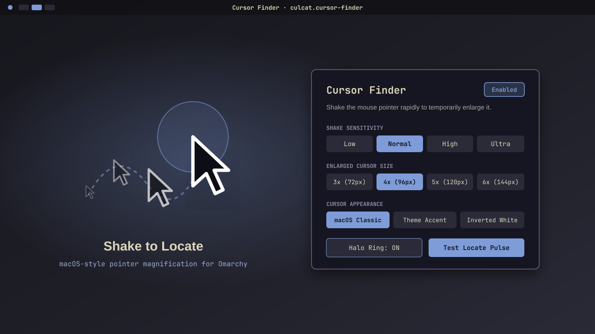

# CursorFinder (`culcat.cursor-finder`)



macOS-style **"Shake mouse pointer to locate"** plugin for **Omarchy** (`omarchy-shell` / Hyprland).

When you rapidly shake the mouse back and forth, the cursor smoothly scales up into a crisp high-DPI vector pointer so you can immediately spot it on large or multi-monitor setups, then smoothly shrinks back when you stop.

---

## Features / Возможности

- **macOS-accurate Shake Detection**: Tracks directional pointer strokes and rapid direction reversals over a sliding window — ignores normal fast flicks across the screen while triggering immediately on genuine back-and-forth shakes.
- **Razor-Sharp Vector Overlay**: Renders a high-DPI vector cursor (`QtQuick.Shapes` `CurveRenderer`) on a click-through `WlrLayer.Overlay` surface across all monitors. Works consistently over Wayland native apps, XWayland, Electron, browsers, and terminals without the ~60ms compositor freeze caused by `hyprctl setcursor`.
- **Zero Idle Overhead**: Communicates directly with Hyprland's UNIX socket (`.socket.sock`) using adaptive polling (`25 Hz` idle, `83 Hz` moving, `125 Hz` while enlarged) and emits zero QML updates until a shake occurs.
- **Built-in Settings Panel & CLI IPC**: Includes an interactive Omarchy settings panel (`Panel.qml`) and full `omarchy-shell cursor-finder` IPC controls.

---

## Requirements & Dependencies / Зависимости

- **Omarchy** (`omarchy-shell` / Quickshell)
- **Hyprland** (`>= 0.50`)
- **Python 3** (`python3`, standard library only — no third-party pip packages required)

---

## Installation / Установка

Install and enable directly via Omarchy's plugin manager:

```bash
omarchy plugin add https://github.com/culcat/CursorFinder.git --enable
```

Or via SSH:

```bash
omarchy plugin add git@github.com:culcat/CursorFinder.git --enable
```

### Updating / Обновление

```bash
omarchy plugin update culcat.cursor-finder
```

### Removal / Удаление

Disable or completely remove the plugin at any time:

```bash
omarchy plugin disable culcat.cursor-finder
omarchy plugin remove culcat.cursor-finder
```

---

## Usage & IPC Commands / Управление

Open the interactive settings panel:

```bash
omarchy-shell cursor-finder settings
# or:
omarchy-shell shell toggle culcat.cursor-finder '{}'
```

Trigger a manual locate pulse (can also be bound to a hotkey in `~/.config/hypr/bindings.lua`):

```bash
omarchy-shell cursor-finder locate
```

### Keybindings / Хоткеи (`~/.config/hypr/bindings.lua`)

Add to `~/.config/hypr/bindings.lua`:

```lua
o.bind("SUPER + ALT + C", "Cursor Finder settings", "omarchy-shell cursor-finder settings")
o.bind("SUPER + CTRL + ALT + C", "Locate cursor", "omarchy-shell cursor-finder locate")
```

Check status or change settings from the terminal:

```bash
omarchy-shell cursor-finder status
omarchy-shell cursor-finder toggle
omarchy-shell cursor-finder set sensitivity 1.4
omarchy-shell cursor-finder set maxScale 5.0
omarchy-shell cursor-finder set cursorStyle theme   # macos | theme | inverted
omarchy-shell cursor-finder set showHalo true
```

---

## Configuration / Конфигурация

Settings are persisted automatically in `~/.config/omarchy/cursor-finder.json` (and mirrored inline in `~/.config/omarchy/shell.json`):

```json
{
  "enabled": true,
  "sensitivity": 1.0,
  "maxScale": 4.2,
  "baseSize": 24,
  "holdMs": 480,
  "cursorStyle": "macos",
  "showHalo": false,
  "hideNativeCursor": true
}
```

---

## Security & Permissions / Безопасность

- Runs entirely in user space as a child process of `omarchy-shell`.
- Communicates solely with Hyprland's local IPC socket (`$XDG_RUNTIME_DIR/hypr/$HYPRLAND_INSTANCE_SIGNATURE/.socket.sock`).
- Operates completely offline within the local graphical session and automatically restores the native hardware cursor on exit or reload.

---

## License

Released under the [MIT License](./LICENSE).
